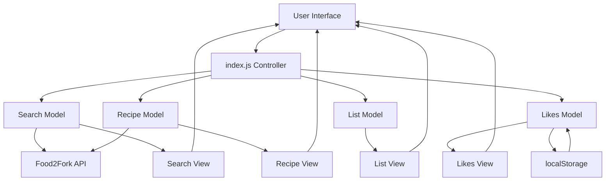
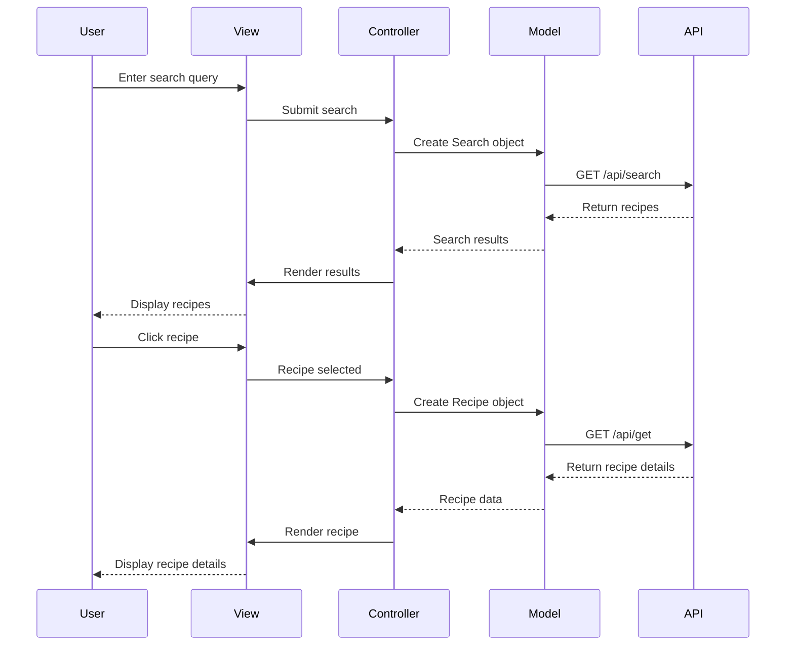

# Forkify Search Over 1 000 000 Recipes

Forkify is a modern recipe search application built with vanilla JavaScript (ES6) that lets users search, view, and manage recipes from a database of over 1,000,000 recipes via the Food2Fork API.

Built in July 2018, it demonstrates the MVC architecture with Webpack bundling and responsive design. Features include recipe search, detailed views with ingredients and instructions, adjustable servings with automatic recalculation, shopping list management, and favorites saved in localStorage. Optimized UX.

## Features

- 🔍 Search through 1,000,000+ recipes from Food2Fork API
- 📖 View detailed recipe information with ingredients and cooking instructions
- 🍽️ Adjust serving sizes with automatic ingredient recalculation
- 🛒 Add ingredients to a shopping list with quantity management
- ❤️ Save favorite recipes with localStorage persistence
- 📱 Fully responsive design for mobile and desktop
- ⚡ Fast and optimized with Webpack bundling
- 🎨 Clean, modern UI with smooth animations

### Core Capabilities

- **Recipe Search**: Search through a database of over 1 million recipes with real-time results
- **Recipe Details**: View complete recipe information including ingredients, cooking time, and serving sizes
- **Serving Adjustment**: Dynamically adjust serving sizes with automatic ingredient quantity recalculation
- **Shopping List**: Add recipe ingredients to a shopping list with quantity management
- **Favorites System**: Save favorite recipes with localStorage persistence across sessions
- **Responsive Design**: Fully responsive UI for all device sizes

### Technical Excellence

- **MVC Architecture**: Clean separation of concerns with Models, Views, and Controllers
- **Webpack Bundling**: Modern build system with hot module replacement
- **ES6+ JavaScript**: Modern JavaScript features with Babel transpilation
- **Axios Integration**: HTTP client for API requests with CORS proxy
- **LocalStorage Persistence**: Favorites data saved across browser sessions

### Developer Experience

- **Hot Reloading**: Development server with hot module replacement
- **Clean Codebase**: Well-structured code following MVC pattern
- **Configuration Files**: Centralized API and build configuration
- **Clear Directory Structure**: Organized by models, views, and utilities

## Usage

### Development Server

Start the development server with hot reload:

```bash
npm start
```

Then open your browser at `http://localhost:8080`

### Production Build

Create an optimized production build:

```bash
npm run build
```

The build output will be in the `dist/` directory.

### Using the Application

1. **Search for Recipes**: Enter a search term in the search field and press Enter or click the search button
2. **View Results**: Browse through the paginated search results
3. **Select a Recipe**: Click on any recipe to view detailed information
4. **Adjust Servings**: Use the + and - buttons to adjust serving sizes
5. **Add to Shopping List**: Click "Add to shopping list" to add all ingredients
6. **Save to Favorites**: Click the heart icon to save/remove from favorites

## Getting Started

### Prerequisites

- Node.js (v12 or higher)
- npm or yarn
- Modern web browser (Chrome, Firefox, Safari, Edge)

### Installation

1. Clone the repository:

```bash
git clone https://github.com/orassayag/forkify-search-over-1-000-000-recipes.git
cd forkify-search-over-1-000-000-recipes
```

2. Install dependencies:

```bash
npm install
```

3. Start the development server:

```bash
npm start
```

4. Open your browser to `http://localhost:8080`

### Building for Production

Create an optimized production build:

```bash
npm run build
```

The build output will be in the `dist/` directory.

## Configuration

### API Configuration

The application uses the Food2Fork API. Configuration is located in `src/js/config.js`:

- **Proxy URL**: CORS proxy for API requests
- **API Key**: Your Food2Fork API key (demo key included)

### Webpack Configuration

Webpack configuration is in `webpack.config.js`:

- **Entry Point**: `src/js/index.js`
- **Output Directory**: `dist/`
- **Dev Server Port**: 8080

## Architecture Principles

This project follows clean architecture principles:

1. **Separation of Concerns**: Strict MVC pattern with clear distinction between Models, Views, and Controllers
2. **Single Responsibility**: Each module has one primary responsibility
3. **Testability**: Pure functions and modular design for easy testing
4. **Maintainability**: Well-organized codebase with clear naming conventions
5. **Configuration Management**: Centralized configuration files for easy customization

## Design Patterns

- **MVC Pattern**: Models handle data, Views handle UI, Controllers handle logic
- **Observer Pattern**: Views update when model data changes
- **Factory Pattern**: Creating model instances
- **Module Pattern**: Encapsulating private implementation details

## Directory Structure

```
forkify-search-over-1-000-000-recipes/
├── src/
│   ├── js/
│   │   ├── models/              # Business logic and data models
│   │   │   ├── Search.js        # Search API integration and results
│   │   │   ├── Recipe.js        # Recipe data parsing and calculations
│   │   │   ├── List.js          # Shopping list management
│   │   │   └── Likes.js         # Favorites persistence with localStorage
│   │   ├── views/               # UI components and rendering
│   │   │   ├── searchView.js    # Search results display
│   │   │   ├── recipeView.js    # Recipe details rendering
│   │   │   ├── listView.js      # Shopping list UI
│   │   │   ├── likesView.js     # Favorites menu
│   │   │   └── base.js          # Shared DOM utilities and elements
│   │   ├── index.js             # Main controller and application entry
│   │   └── config.js            # API and application configuration
│   ├── css/
│   │   └── style.css            # Application styling
│   └── index.html               # HTML template
├── dist/                        # Production build output
├── webpack.config.js            # Webpack bundler configuration
├── .babelrc                     # Babel transpiler configuration
├── package.json                 # Project dependencies and scripts
└── README.md                    # Project documentation
```

## Best Practices

### Code Style

- Use ES6+ syntax with arrow functions, template literals, and destructuring
- Follow MVC architecture for code organization
- Use meaningful variable and function names
- Keep functions focused and single-purpose

### Development Workflow

- Always test changes in development mode first
- Check browser console for errors
- Verify responsive design across device sizes
- Test favorites persistence by refreshing the page

### Adding New Features

1. Create a new model in `src/js/models/` for data logic
2. Create a corresponding view in `src/js/views/` for UI
3. Add controller logic in `src/js/index.js`
4. Test thoroughly before committing

## Application Architecture



## MVC Architecture Flow



## Features in Detail

### Recipe Search

- Real-time search through 1M+ recipes
- Pagination (10 results per page)
- Visual loading indicators
- Error handling for failed requests

### Recipe Details

- Ingredient list with smart parsing
- Automatic cooking time estimation
- Adjustable servings with live calculation
- Direct link to original recipe source

### Shopping List

- Add entire recipe ingredients
- Edit quantities inline
- Remove individual items
- Persistent during session

### Favorites System

- Like/unlike recipes
- Persistent storage using localStorage
- Quick access dropdown menu
- Visual indicators

## Technology Stack

- **JavaScript ES6+** - Modern JavaScript features
- **Webpack 4** - Module bundling and build optimization
- **Babel 6** - ES6+ to ES5 transpilation
- **Axios** - HTTP client for API requests
- **HTML5 & CSS3** - Semantic markup and modern styling
- **MVC Pattern** - Clean separation of concerns

## Project Structure

```
forkify-search-over-1-000-000-recipes/
├── src/
│   ├── js/
│   │   ├── models/              # Business logic and data
│   │   │   ├── Search.js        # Search API integration
│   │   │   ├── Recipe.js        # Recipe data and parsing
│   │   │   ├── List.js          # Shopping list management
│   │   │   └── Likes.js         # Favorites with localStorage
│   │   ├── views/               # UI rendering
│   │   │   ├── searchView.js    # Search results display
│   │   │   ├── recipeView.js    # Recipe details rendering
│   │   │   ├── listView.js      # Shopping list UI
│   │   │   ├── likesView.js     # Favorites menu
│   │   │   └── base.js          # Shared DOM utilities
│   │   ├── index.js             # Main controller
│   │   └── config.js            # API configuration
│   ├── css/
│   │   └── style.css            # Application styles
│   └── index.html               # HTML template
├── dist/                        # Production build output
├── webpack.config.js            # Webpack configuration
├── .babelrc                     # Babel configuration
├── package.json                 # Dependencies and scripts
└── README.md
```

## Available Scripts

| Command         | Description                              |
| --------------- | ---------------------------------------- |
| `npm start`     | Start development server with hot reload |
| `npm run dev`   | Build in development mode                |
| `npm run build` | Build optimized production bundle        |

## API Integration

The application uses the [Food2Fork API](https://www.food2fork.com/about/api):

- **Search endpoint**: Returns recipe list based on query
- **Get endpoint**: Returns detailed recipe information
- **CORS proxy**: Uses cors-anywhere for cross-origin requests

## Browser Support

- Chrome (latest)
- Firefox (latest)
- Safari (latest)
- Edge (latest)

The application uses Babel for transpilation to ensure compatibility with older browsers.

## Known Limitations

- API rate limits may apply with demo key
- Recipe database depends on Food2Fork availability
- Requires internet connection for recipe data

## Contributing

Contributions to this project are [released](https://help.github.com/articles/github-terms-of-service/#6-contributions-under-repository-license) to the public under the [project's open source license](LICENSE).

Everyone is welcome to contribute. Contributing doesn't just mean submitting pull requests—there are many different ways to get involved, including answering questions, reporting issues, improving documentation, or suggesting new features.

See [CONTRIBUTING.md](CONTRIBUTING.md) for detailed guidelines.

## Author

- **Or Assayag** - _Initial work_ - [orassayag](https://github.com/orassayag)
- Or Assayag <orassayag@gmail.com>
- GitHub: https://github.com/orassayag
- StackOverflow: https://stackoverflow.com/users/4442606/or-assayag?tab=profile
- LinkedIn: https://linkedin.com/in/orassayag

## License

This application has an MIT license - see the [LICENSE](LICENSE) file for details.

## Acknowledgments

- Built for educational and research purposes
- Respects robots.txt and implements rate limiting
- Uses user-agent rotation to avoid detection
- Implements polite crawling practices
