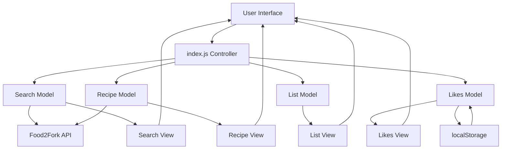
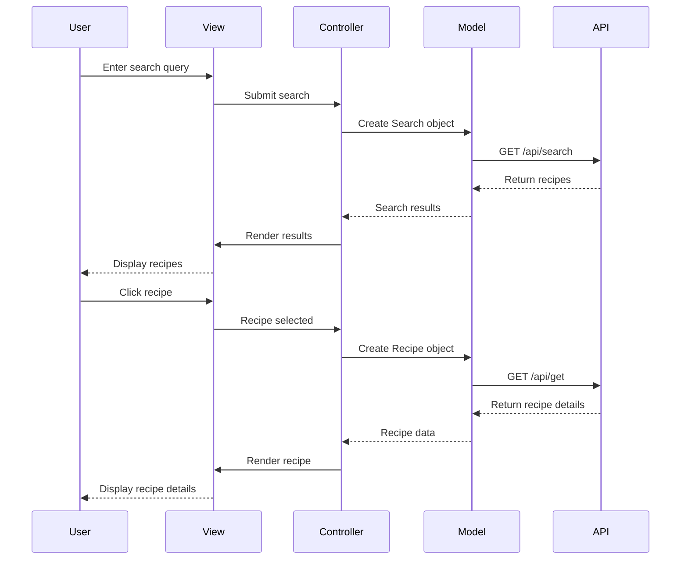

# Forkify - Search Over 1,000,000 Recipes

A modern recipe search application built with vanilla JavaScript ES6, allowing users to search, view, and manage recipes from a database of over 1 million recipes using the Food2Fork API.

Built in July 2018. This application demonstrates the MVC (Model-View-Controller) architecture pattern with modern JavaScript ES6+, Webpack bundling, and responsive web design.

## Features

- 🔍 Search through 1,000,000+ recipes from Food2Fork API
- 📖 View detailed recipe information with ingredients and cooking instructions
- 🍽️ Adjust serving sizes with automatic ingredient recalculation
- 🛒 Add ingredients to a shopping list with quantity management
- ❤️ Save favorite recipes with localStorage persistence
- 📱 Fully responsive design for mobile and desktop
- ⚡ Fast and optimized with Webpack bundling
- 🎨 Clean, modern UI with smooth animations

## Getting Started

### Prerequisites

- Node.js (v12 or higher)
- npm or yarn
- Modern web browser (Chrome, Firefox, Safari, Edge)

### Installation

1. Clone the repository:
```bash
git clone https://github.com/orassayag/forkify-search-over-1-000-000-recipes.git
cd forkify-search-over-1-000-000-recipes
```

2. Install dependencies:
```bash
npm install
```

3. Start the development server:
```bash
npm start
```

4. Open your browser to `http://localhost:8080`

### Building for Production

Create an optimized production build:
```bash
npm run build
```

The build output will be in the `dist/` directory.

## Application Architecture



## MVC Architecture Flow



## Features in Detail

### Recipe Search
- Real-time search through 1M+ recipes
- Pagination (10 results per page)
- Visual loading indicators
- Error handling for failed requests

### Recipe Details
- Ingredient list with smart parsing
- Automatic cooking time estimation
- Adjustable servings with live calculation
- Direct link to original recipe source

### Shopping List
- Add entire recipe ingredients
- Edit quantities inline
- Remove individual items
- Persistent during session

### Favorites System
- Like/unlike recipes
- Persistent storage using localStorage
- Quick access dropdown menu
- Visual indicators

## Technology Stack

- **JavaScript ES6+** - Modern JavaScript features
- **Webpack 4** - Module bundling and build optimization
- **Babel 6** - ES6+ to ES5 transpilation
- **Axios** - HTTP client for API requests
- **HTML5 & CSS3** - Semantic markup and modern styling
- **MVC Pattern** - Clean separation of concerns

## Project Structure

```
forkify-search-over-1-000-000-recipes/
├── src/
│   ├── js/
│   │   ├── models/              # Business logic and data
│   │   │   ├── Search.js        # Search API integration
│   │   │   ├── Recipe.js        # Recipe data and parsing
│   │   │   ├── List.js          # Shopping list management
│   │   │   └── Likes.js         # Favorites with localStorage
│   │   ├── views/               # UI rendering
│   │   │   ├── searchView.js    # Search results display
│   │   │   ├── recipeView.js    # Recipe details rendering
│   │   │   ├── listView.js      # Shopping list UI
│   │   │   ├── likesView.js     # Favorites menu
│   │   │   └── base.js          # Shared DOM utilities
│   │   ├── index.js             # Main controller
│   │   └── config.js            # API configuration
│   ├── css/
│   │   └── style.css            # Application styles
│   └── index.html               # HTML template
├── dist/                        # Production build output
├── webpack.config.js            # Webpack configuration
├── .babelrc                     # Babel configuration
├── package.json                 # Dependencies and scripts
└── README.md
```

## Available Scripts

| Command | Description |
|---------|-------------|
| `npm start` | Start development server with hot reload |
| `npm run dev` | Build in development mode |
| `npm run build` | Build optimized production bundle |

## API Integration

The application uses the [Food2Fork API](https://www.food2fork.com/about/api):
- **Search endpoint**: Returns recipe list based on query
- **Get endpoint**: Returns detailed recipe information
- **CORS proxy**: Uses cors-anywhere for cross-origin requests

## Browser Support

- Chrome (latest)
- Firefox (latest)
- Safari (latest)
- Edge (latest)

The application uses Babel for transpilation to ensure compatibility with older browsers.

## Development

### Code Style
- ES6 modules with import/export
- Async/await for asynchronous operations
- MVC pattern for code organization
- Functional programming principles

### Adding New Features
1. Create model in `src/js/models/` for data logic
2. Create view in `src/js/views/` for UI rendering
3. Add controller logic in `src/js/index.js`
4. Test thoroughly across browsers

## Known Limitations

- API rate limits may apply with demo key
- Recipe database depends on Food2Fork availability
- Requires internet connection for recipe data

## Contributing

Contributions to this project are [released](https://help.github.com/articles/github-terms-of-service/#6-contributions-under-repository-license) to the public under the [project's open source license](LICENSE).

Everyone is welcome to contribute. Contributing doesn't just mean submitting pull requests—there are many different ways to get involved, including answering questions, reporting issues, improving documentation, or suggesting new features.

See [CONTRIBUTING.md](CONTRIBUTING.md) for detailed guidelines.

## Author

* **Or Assayag** - *Initial work* - [orassayag](https://github.com/orassayag)
* Or Assayag <orassayag@gmail.com>
* GitHub: https://github.com/orassayag
* StackOverflow: https://stackoverflow.com/users/4442606/or-assayag?tab=profile
* LinkedIn: https://linkedin.com/in/orassayag

## License

This application has an MIT license - see the [LICENSE](LICENSE) file for details.
